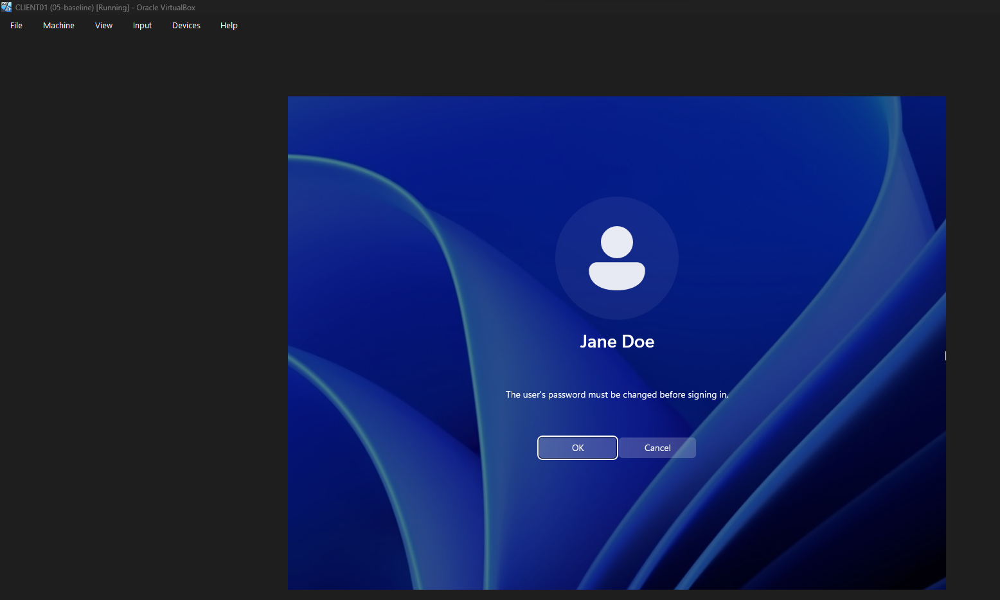
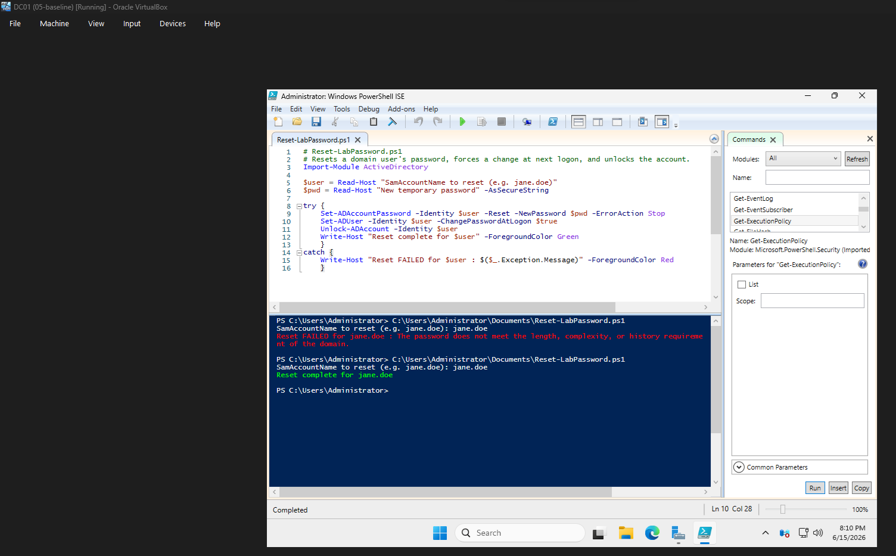

# Active Directory Home Lab — Windows Server 2025

A fully functional **Active Directory domain** built from scratch in virtual machines: a Windows Server 2025 domain controller running **AD DS, DNS, and DHCP**, with a domain-joined Windows 11 client. The lab covers the full day-to-day work of an IT Support / Help Desk role — user and group administration, Group Policy, PowerShell automation, and baseline security hardening — and documents the *why* behind each decision, not just the clicks.

**Built and documented by Charbel Touma** · [github.com/ctouma21-dev](https://github.com/ctouma21-dev)

---

## What this demonstrates

| Area | Capability shown |
|---|---|
| **Directory services** | Stood up AD DS; designed an OU structure; managed users, groups, and computer objects |
| **Identity lifecycle** | Provisioned, maintained, and deprovisioned accounts following a least-privilege (AGDLP) model |
| **Group Policy** | Authored and linked GPOs for password policy, account lockout, logon banner, and drive mapping |
| **Networking services** | Configured DNS and a DHCP scope; assigned static addressing; troubleshot DNS-based domain-join issues |
| **Automation** | Wrote PowerShell to bulk-provision from CSV, reset/unlock accounts, offboard users, and report on inventory |
| **Security** | Applied baseline hardening and mapped each control to its underlying concept (CompTIA Security+ SY0-701) |


*A scripted password reset forcing a change at next logon — verified end-to-end on CLIENT01.*

---

## Architecture

```
                        [ Windows 11 Host — VirtualBox 7.x ]
                                       │
                     NAT Network: LabNet — 10.10.10.0/24
                  (VirtualBox DHCP off; DC01 is the DHCP server)
            ___________________________│___________________________
            │                                                     │
   +------------------------+                      +------------------------+
   │         DC01           │                      │       CLIENT01         │
   │  Windows Server 2025   │                      │      Windows 11        │
   │  AD DS · DNS · DHCP     │                      │  Domain member of      │
   │  Static IP 10.10.10.10 │                      │       corp.lab         │
   │  DNS → itself          │                      │  DHCP + DNS from DC01  │
   +------------------------+                      +------------------------+

   Domain: corp.lab  (NetBIOS: CORP)        Internet via NAT gateway 10.10.10.1
```

**Key addressing**

| Setting | Value |
|---|---|
| Domain (FQDN / NetBIOS) | `corp.lab` / `CORP` |
| DC01 (static) | `10.10.10.10`, DNS → `127.0.0.1` |
| DHCP scope | `10.10.10.100 – 10.10.10.200`, DNS `10.10.10.10` |
| Gateway | `10.10.10.1` |

---

## How it was built (10 stages)

1. Install VirtualBox and configure storage
2. Build the isolated lab network (NAT Network, VirtualBox DHCP disabled)
3. Create and install the Windows Server 2025 VM
4. Promote DC01 to a domain controller (new forest `corp.lab`)
5. Verify DNS and configure a DHCP scope
6. Build and domain-join the Windows 11 client
7. Design the Organizational Unit structure
8. Create users and groups (AGDLP model; bulk-provision from CSV)
9. Author and link Group Policy Objects
10. Automate routine administration with PowerShell

Each stage was snapshotted at a known-good point, so the entire lab is rebuildable on demand.

---

## Automation (`scripts/`)

| Script | Purpose |
|---|---|
| `New-LabUsers.ps1` + `newusers.csv` | Bulk-provision domain users from CSV with per-department OU targeting |
| `Reset-LabPassword.ps1` | Reset a password, force change at next logon, and unlock — with error handling |
| `Disable-LabUser.ps1` | Offboard a departed user: disable, timestamp, and move to a holding OU |
| `Get-LabUserReport.ps1` | Export enabled users to CSV and flag accounts that have never logged on |

> The reset and offboard scripts use `try/catch` with `-ErrorAction Stop` so they fail honestly instead of reporting false success, and prompt for secrets at runtime rather than hardcoding credentials.


*The reset script failing honestly on a weak password, then succeeding cleanly — instead of reporting false success.*

---

## Repository structure

```
active-directory-home-lab/
├─ README.md                ← you are here
├─ docs/                    build guide, per-stage write-ups, diagrams
├─ scripts/                 PowerShell automation + newusers.csv
├─ screenshots/             evidence captures, organized by stage
└─ hardening-checklist.md   security controls, mapped to concepts
```

## Documentation

- **`docs/AD_Home_Lab_Guide`** — the full 18-section build & hardening guide
- **`docs/AD_Lab_Tips`** — golden rules, common gotchas, and a command cheat sheet
- **Per-stage write-ups** (`docs/StageX.md`) — each in a dual-narrative format: a clean build walkthrough plus a standalone troubleshooting case study with root-cause analysis
- **`hardening-checklist.md`** — baseline security controls, what was implemented, and the concept each represents

---

## Notes

- Domain uses a `.lab` suffix to avoid any clash with public DNS.
- The lab is self-contained and free; everything runs locally on a single PC.
- Credentials and sensitive files are deliberately excluded from this repository.

*Built once by hand to learn it, then automated where it counts.*
